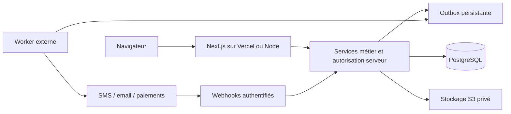

# Architecture

## Décision

Monolithe modulaire Next.js App Router / TypeScript strict, PostgreSQL et Prisma avec adaptateur pg. Server Components pour le public, composants client pour filtres et interactions. Tailwind et primitives compatibles shadcn/ui ; Lucide. Pas de dépendance à PostgreSQL pour afficher la page de démonstration.

## Modules et frontières

`src/app` : routes et présentation ; `src/components/ui` : composants ; `src/modules/catalog` : données de démonstration et filtres ; `src/modules/identity` : politique pure RBAC ; `src/lib/server` : connexion Prisma, attribution de numéro ; `prisma` : schéma, migrations et seed ; `tests` : règles métier et E2E. Futures frontières : listings, bookings, billing, media, tours, notifications, administration. API future `/api/v1`, DTO Zod séparés des modèles Prisma, pagination par curseur, erreurs stables sans secrets.

## Identité — première étape du MVP

Sessions scellées avec iron-session et tokens opaques hachés en base, révocables et expirant après huit heures. Inscription CLIENT, connexion téléphone/email, bcrypt coût 12, contrôle d'origine, limites atomiques persistantes, audits et pages privées sont intégrés. Le serveur recharge acteur, permissions et périmètre à chaque accès privé ; les données client ne peuvent attribuer ni rôle ni société. L'annuaire d'équipe est en lecture seule. Voir [authentication.md](authentication.md) pour les limites, routes, commandes et prérequis d'ouverture publique.

## Hiérarchie

Adjacency list `UserHierarchy` (parent unique), société obligatoire pour les comptes persistés. Prévention des cycles et déplacement de sous-arbre sous transaction au MVP. Seul SUPER_ADMIN peut traverser les sociétés ; aucune mutation sensible sur lui-même ou un pair. DEFAULT_COMMERCIAL fournit le rattachement des nouveaux clients, pas une permission supplémentaire. Numéro BARKA-DYYYYNNNNN : compteur annuel atomique `upsert` dans la même transaction que le profil, unicité en base, refus au-delà de 99999.

## Paiements et tâches (conception)

PaymentProvider : createIntent, verify, authenticateWebhook, refund. Mock exclusivement en développement/test avec refus explicite en production à implémenter avant activation. Statuts PENDING/SUCCESS/FAILED/REFUNDED. Webhook : signature sur corps brut, vérification prestataire serveur du montant/devise/bénéficiaire, événement unique `(provider,eventId)`, verrou transactionnel et transition monotone. Journal, droit d'accès, reçu et outbox créés ensemble. Aucune confiance dans la redirection du navigateur. Commissions versionnées et calculées sur montants entiers. Pas de fournisseur réel validé à cette étape.

## Médias et 360° (conception)

Metadata en base, objets S3 privés. URL de dépôt signée à durée courte après RBAC, limites de taille et MIME, contrôle réel du contenu et scan, worker de compression, statut READY après validation. Panorama via Pannellum/Marzipano chargé à la demande, scènes/hotspots et FloorPlan ; GLB/GLTF via Three.js ultérieurement. Matterport : allowlist stricte de domaines/identifiants, pas d'iframe arbitraire. Aucun panorama fourni en phase 1 faute de média autorisé.

## Déploiement et exploitation

Vercel : runtime Node, PostgreSQL managé avec pool de connexions, migrations via tâche CI séparée `db:deploy`, stockage objet externe et worker/planificateur externe pour jobs persistants. Pas de disque local durable ou de processus de fond après une réponse HTTP. Alternative VPS Node/Docker, reverse proxy HTTPS et PostgreSQL protégé ; hébergement PHP seul incompatible.

Budgets à chiffrer au choix des prestataires : compute Next.js, PostgreSQL et sauvegardes, stockage/egress/CDN, worker/file, email/SMS/WhatsApp, domaine, monitoring, frais de paiement. Aucun prix d'infrastructure garanti. Les médias et le trafic 360° peuvent dominer les coûts.

Sauvegardes : dump chiffré quotidien et restauration ponctuelle/PITR selon offre, versioning objet, rétention décidée avec métier. Restaurer dans une base isolée, appliquer migrations, vérifier comptes/dossiers et objets, mesurer RPO/RTO puis documenter le test avant ouverture. Journalisation structurée sans mots de passe, documents ni contacts protégés ; alertes sur échecs jobs/webhooks et accès refusés. Politique de conservation et procédure de suppression à approuver avant collecte réelle.

## Références techniques

- https://nextjs.org/docs/app/getting-started/installation
- https://docs.prisma.io/docs/orm/prisma-client/setup-and-configuration/introduction
